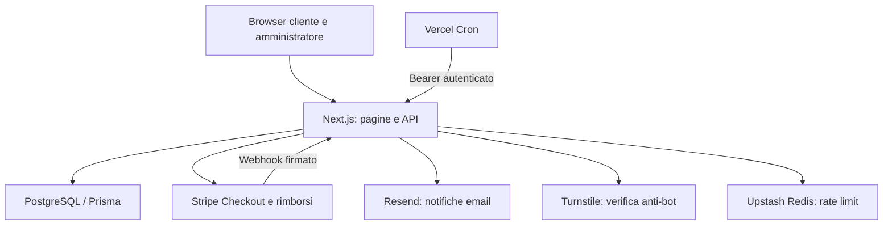

# ARC-01 — Architettura e flussi

**Release 2.1.0 · 26 ottobre 2026**

## Vista del sistema

Next.js esegue rendering, API e controlli di accesso su Vercel. PostgreSQL conserva lo stato autorevole. Stripe gestisce la pagina di pagamento; il sito conserva identificativi e stati del pagamento, senza dati completi della carta. Le email vengono prima registrate nell’outbox e poi inviate.

## Strati e responsabilità

| Strato | Cartelle | Responsabilità |
|---|---|---|
| Presentazione | app, components | Navigazione, modulo ordine, conferma e backoffice |
| Confine HTTP | app/api, proxy.ts, lib/http.ts | Autenticazione, Origin, body limitati, errori e header |
| Servizi applicativi | lib/checkout, presale, expiry, refunds, notifications | Regole di vendita e coordinamento dei provider |
| Persistenza | Prisma e migrazioni | Transazioni, vincoli, dati economici e audit |
| Operazioni | scripts, workflow e configurazione Vercel | Collaudo, migrazioni, controllo ambiente e deploy |

## Ordine e conferma

1. Il browser legge prezzo, termini, taglie e revisione da `/api/status`.
2. La richiesta ordine supera Origin, rate limit, schema e Turnstile.
3. `reserveOrder` acquisisce il lock delle impostazioni e verifica apertura, stock, limiti e versione dei termini. La prenotazione riceve chiave idempotente e snapshot.
4. `createCheckout` crea o riutilizza la sessione Stripe. Ricontrolla l’apertura dopo la risposta del provider e annulla il checkout se nel frattempo la raccolta è stata chiusa.
5. Il webhook verifica la firma sul body originale e la modalità TEST/LIVE. Il processore confronta valuta, importo, Session ID e PaymentIntent.
6. Nella transazione vengono aggiornati ordine, date, evento processato, notifica e soglia. Il ritorno del browser legge lo stato, senza confermare pagamenti autonomamente.

Il contatore si aggiorna con polling ogni 15 secondi. La pagina conferma interroga lo stato pending ogni 1,5 secondi, con un numero limitato di tentativi.

## Stati indipendenti

| Dimensione | Stati principali | Regola |
|---|---|---|
| Apertura | APERTA / CHIUSA | Decisione amministrativa; indipendente dalla soglia |
| Produzione | IN_RACCOLTA → SOGLIA_RAGGIUNTA → PRODUZIONE_AVVIATA → PRODUZIONE_COMPLETATA | Avvio e completamento sono amministrativi; dopo l’avvio non si torna indietro |
| Pagamento | PENDING / PAID / FAILED | PAID richiede evidenza autenticata Stripe |
| Rimborso | NONE / PENDING / REFUNDED / FAILED | Timeout non significa rifiuto; pieno rimborso esclude i pezzi dal contatore |
| Consegna | DA_CONSEGNARE / SERATA_RUSH / PR / CONSEGNATA | Modificabile per ordine pagato senza rimborso |

La soglia può essere raggiunta con raccolta ancora aperta. L’avvio della produzione non chiude la vendita. La successiva chiusura non elimina gli ordini.

## Scadenze e rimborsi

Ogni pagamento confermato determina la propria scadenza con mesi di calendario, non con un numero fisso di giorni. `expiryPreview` legge scaduti, preavvisi e operazioni pendenti; `runExpiry` svolge batch limitati. Un intento di rimborso viene scritto prima della chiamata Stripe. La chiave idempotente e il successivo confronto con il provider permettono riconciliazione dopo interruzioni.

L’avvio produzione e il rimborso condividono il lock delle impostazioni. L’avvio viene negato se esistono intenti automatici ambigui pendenti. I processi conservano stato e audit; non correggere esiti incerti riscrivendo manualmente i dati economici.

## Vincoli di esercizio

Il lock globale privilegia la coerenza rispetto al throughput. I batch sono limitati: al crescere dei volumi occorre verificare backlog, frequenza cron, timeout e pool DB. L’infrastruttura di test non misura prestazioni o SLA commerciali.
