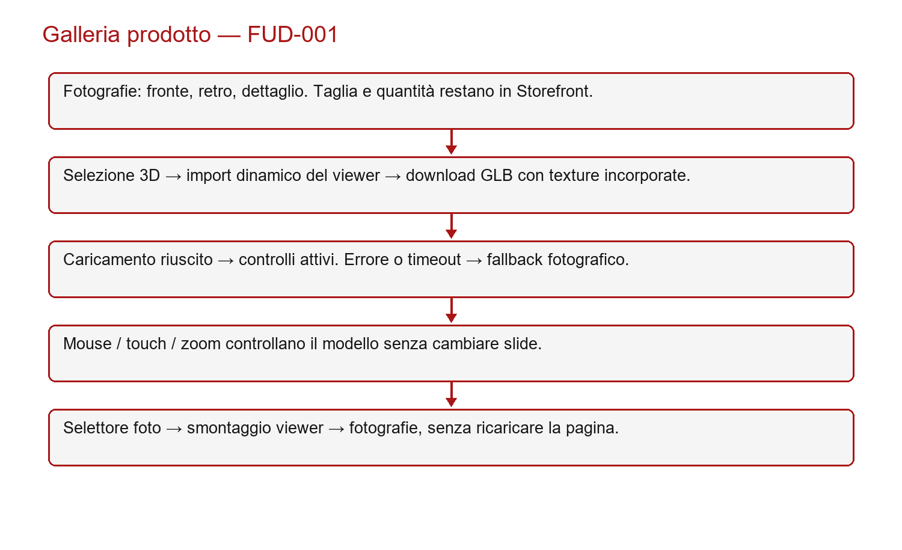
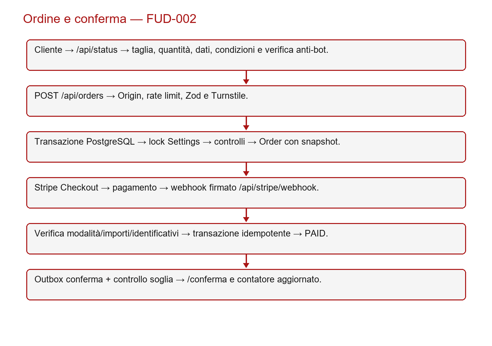
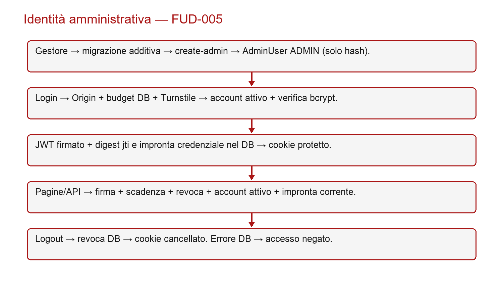

# FUD — Functional User Design

## 1. Ambito funzionale e navigazione
L’applicazione espone home, PRE-SALE, conferma ordine e pagine informative. Il backoffice comprende login, dashboard e impostazioni. Il prodotto è la maglietta RUSH; la gestione commerciale consiste nella configurazione del prodotto unico, senza CRUD di un catalogo generalista. FUD-001–FUD-010 descrivono i casi d’uso e rimandano ai requisiti BUR.

## 2. FUD-001 — Consultazione e galleria
Riferimenti: BUR-001–BUR-005, BUR-025. Il cliente apre PRE-SALE. Il sistema mostra le fotografie originali e interroga /api/status per prezzo, taglie, soglia, apertura e condizioni. In assenza di risposta mostra uno stato non disponibile e non abilita il pagamento.

I tre selettori fotografici cambiano immagine; il click apre un dialogo ingrandito. Il quarto selettore monta RushShirt3D. Una barra segue gli eventi progress; load abilita i controlli. Un errore del motore o del download, oppure il timeout di 45 secondi, porta al fallback fotografico. La selezione di un’altra foto smonta il viewer. I gesti touch del modello non raggiungono il contenitore che gestisce lo scorrimento delle fotografie.

La rotazione automatica è inizialmente attiva salvo preferenza di movimento ridotto. Fronte, retro e ripristino fermano la rotazione; il reset ripristina anche target, campo visivo e zoom. La distanza camera è limitata fra 2 e 12 metri nelle unità del modello. Taglia e quantità appartengono a Storefront e non vengono azzerate dal cambio galleria.

## 3. FUD-002 — Prenotazione e pagamento
Riferimenti: BUR-002, BUR-008–BUR-011. Precondizioni: raccolta aperta, manutenzione disattivata, taglia attiva, disponibilità e limiti rispettati, termini correnti accettati, verifica anti-bot valida. Il browser crea una chiave UUID per il tentativo e la mantiene se i dati non cambiano.

Il server controlla Origin, limite distribuito, dimensione del corpo, schema e Turnstile. Sotto lock delle impostazioni controlla revisione, termini, stock e quantità, poi salva ordine e snapshot. Stripe riceve importo e valuta derivati dal server. Dopo la risposta del provider il sistema ricontrolla apertura/manutenzione, annullando il Checkout se necessario. L’utente viene indirizzato al pagamento solo con una sessione aperta e un URL valido.

Il webhook usa il corpo originale per la firma; verifica modalità, importo, valuta, sessione e PaymentIntent. Il ledger blocca elaborazioni duplicate. Il pagamento PAID determina data, scadenza, conferma in outbox e conteggio soglia. Eventi di fallimento tardivi non annullano un pagamento già confermato. La pagina /conferma legge lo stato e non può dichiarare il pagamento autonomamente.

## 4. FUD-003 — Soglia e stati della raccolta
Riferimenti: BUR-006–BUR-008, BUR-014. La somma considera quantity degli ordini PAID non integralmente rimborsati e non appartenenti ai lotti storici esclusi. Il raggiungimento della soglia porta a SOGLIA_RAGGIUNTA e accoda la notifica amministrativa. presaleOpen resta indipendente.

| Stato / evento | Condizione | Effetto |
|---|---|---|
| Soglia raggiunta | Pezzi validi almeno pari alla soglia | Produzione possibile; raccolta ancora aperta |
| Avvio produzione | Admin, soglia raggiunta, nessun rimborso automatico ambiguo | Timestamp persistente; arresto nuovi rimborsi automatici |
| Completamento | Produzione già avviata | PRODUZIONE_COMPLETATA |
| Chiusura | Decisione admin confermata | Nuovi checkout negati; annullamento/riconciliazione aperti |
| Riapertura | Decisione admin confermata | Nuove prenotazioni ammesse; produzione non azzerata |

Il ritorno sotto soglia prima della produzione può ripristinare IN_RACCOLTA. Dopo l’avvio i vincoli del database impediscono di cancellare il timestamp o tornare a uno stato precedente. Il cambio soglia aggiorna revisione e condizioni per i nuovi ordini.

## 5. FUD-004 — Scadenza e rimborso
Riferimenti: BUR-012–BUR-014, BUR-019. La data di pagamento determina expiresAt con mesi di calendario. warningDays e refundMonths vengono fotografati nell’ordine. L’anteprima legge ordini prossimi alla scadenza, scaduti e operazioni da riconciliare.

Il processo giornaliero in produzione acquisisce batch limitati. Prima del provider persiste RefundOperation con importo residuo e chiave idempotente. Avvio produzione e rimborso usano lo stesso lock. Un timeout conserva lo stato pendente; il successivo tentativo legge i rimborsi del provider prima di richiederne un altro. Il rimborso completo aggiorna Order, accoda le notifiche cliente/admin e ricalcola i pezzi. Un rimborso parziale aggiorna l’importo ma non sottrae l’intera quantità.

Un ordine non ancora scaduto non è idoneo al rimborso automatico. Un amministratore può richiedere un rimborso manuale indipendentemente dalla scadenza, con conferma esplicita. Un esito FAILED definitivo consente un retry manuale tracciato con una nuova chiave; un esito ambiguo richiede riconciliazione.

## 6. FUD-005 — Identità amministrativa
Riferimenti: BUR-015–BUR-016, BUR-022. Il gestore applica la migrazione additiva e inizializza AdminUser dal comando create-admin. L’identità configurata è ADMIN_ID, con fallback nominale rush-admin; il nome non è una credenziale. Email normalizzata e ID sono unici. L’account ha ruolo ADMIN, hash bcrypt e flag active.

Lo script crea solo se assente. Un’identità già presente, attiva e coerente viene lasciata invariata; un’email appartenente a un altro ID o un account incompatibile produce errore senza sovrascrittura. Le esecuzioni concorrenti sono arbitrate dai vincoli del database. Non esiste registrazione amministrativa pubblica.

Il login verifica Origin, budget persistente, CAPTCHA e password dell’account attivo. La sessione JWT include ruolo, subject, issuer, audience, issued-at, scadenza e identificativo casuale. Il database conserva il digest dell’identificativo e un’impronta dell’hash corrente. Ogni richiesta controlla firma, scadenza, revoca, account attivo e impronta. Logout revoca prima di rimuovere il cookie. Errore DB significa accesso negato.

## 7. FUD-006 — Dashboard, ordini ed export
Riferimenti: BUR-017–BUR-018, BUR-020. La dashboard legge in parallelo KPI e ordini e aggiorna i dati ogni 30 secondi. L’elenco supporta ricerca, filtri, ordinamento e paginazione da 25 righe. Una risposta obsoleta non sostituisce quella di una ricerca successiva.

CSV e XLSX rispettano i filtri e includono un riepilogo produttore. I valori potenzialmente interpretabili come formule sono neutralizzati; l’esportazione oltre 10.000 ordini richiede filtri. L’azione di export è registrata in AuditLog. Le modifiche di consegna sono consentite su pagamenti PAID con refundStatus NONE, nuovamente controllati nella transazione.

## 8. FUD-007 — Impostazioni e condizioni
Riferimenti: BUR-011, BUR-021. L’amministratore può modificare prezzo, soglia, disponibilità per taglia, limiti, manutenzione, messaggio di chiusura, durata, preavviso, consegna, destinatari e template. L’input completo deve rispettare lo schema Zod e la revisione corrente. Il sistema rifiuta una modifica basata su dati superati.

Le condizioni devono conservare le clausole PRE-SALE e riflettere soglia, durata e consegna. Ogni testo diverso produce TermsVersion con numero crescente. Gli ordini precedenti mantengono termsVersionId e snapshot: non vengono riscritti dopo una modifica delle impostazioni.

## 9. FUD-008 — Notifiche e diagnostica
Riferimenti: BUR-007, BUR-010, BUR-013, BUR-019, BUR-026. La conferma, la soglia, il preavviso e il rimborso sono accodati con chiavi di deduplicazione. Un lease impedisce a worker concorrenti di inviare simultaneamente lo stesso messaggio. Il provider riceve una chiave idempotente. Dopo una finestra ambigua di 23 ore il reinvio richiede revisione.

In staging l’allowlist limita sia ordini sia recapiti email. La diagnostica amministrativa espone stato DB, ultimi eventi e codici minimizzati. I comandi di prova e riconciliazione restano disponibili soltanto agli amministratori. Nessun mock o controllo di debug viene aggiunto al percorso pubblico.

## 10. FUD-009 — Eccezioni, sicurezza e informazione
Riferimenti: BUR-022–BUR-025. Il server restituisce 400 per input errato, 401 per sessione assente, 403 per origine vietata, 413 per corpo eccessivo, 429 per limite e 503 per indisponibilità. La UI conserva un messaggio leggibile e permette il recupero previsto dal modulo. Stack, credenziali e payload provider non sono messaggi pubblici.

Le pagine legali presentano identità e contatti dalla configurazione del titolare; non costituiscono una validazione legale del servizio. In assenza dei dati reali il lancio LIVE resta bloccato dal preflight. Il banner TEST rimane solo negli ambienti non commerciali per rendere esplicita la modalità dei pagamenti.

## 11. FUD-010 — Collaudo e consegna
Riferimenti: BUR-023, BUR-026–BUR-027. I runner creano schemi casuali su un database locale rush_audit*. Integrazione e HTTP usano PostgreSQL reale e adattatori Stripe/Resend controllati. Il browser verifica rendering e interazioni reali del GLB, inclusa CSP, senza effettuare acquisti esterni. Backup/ripristino usa due database temporanei distinti.

La prova remota di checkout, recapito, rimborso, cron e compatibilità del dispositivo fisico deve essere registrata separatamente. Il registro Excel mantiene PASS, FAIL, BLOCKED e NOT RUN e non converte un requisito implementato in un test eseguito.
