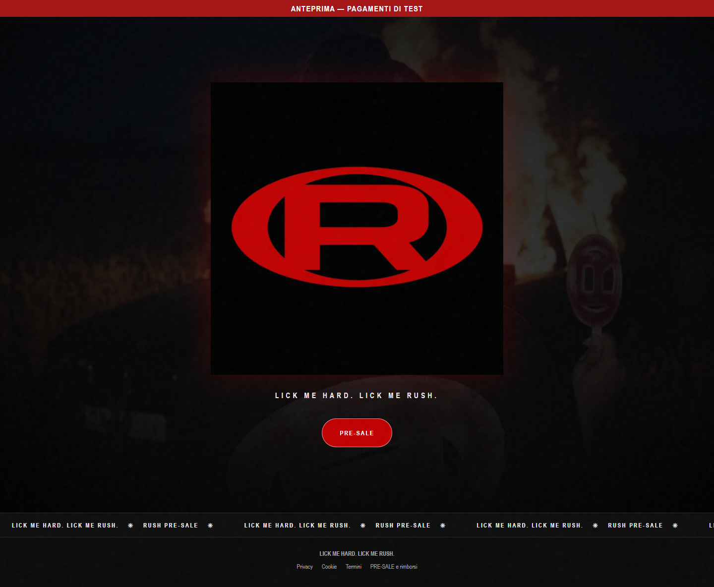
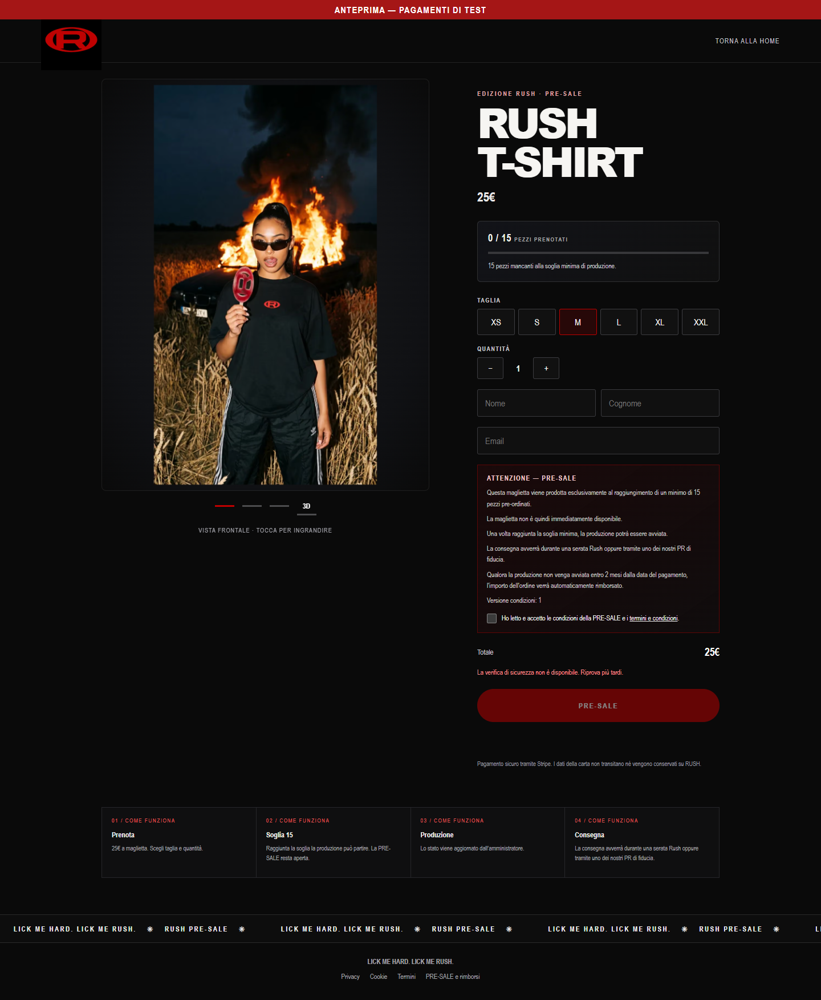
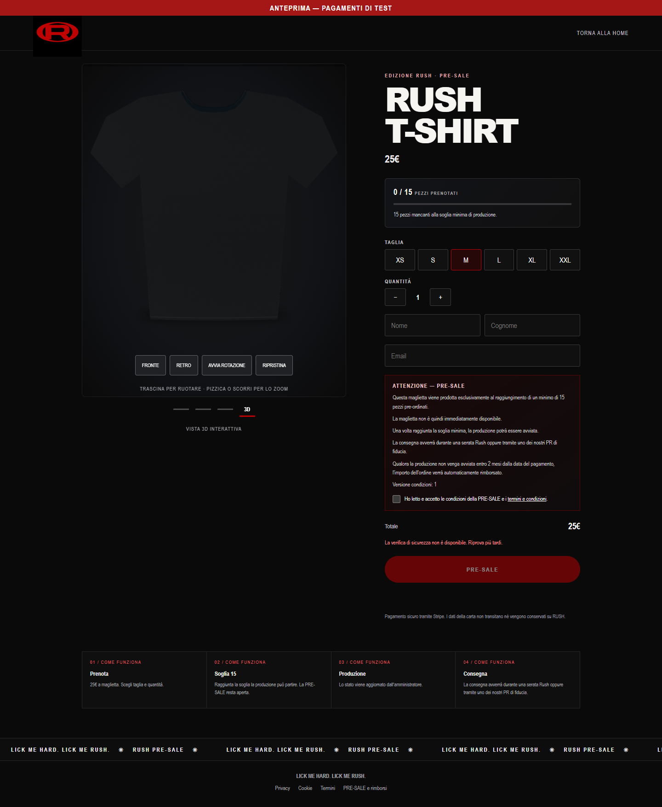
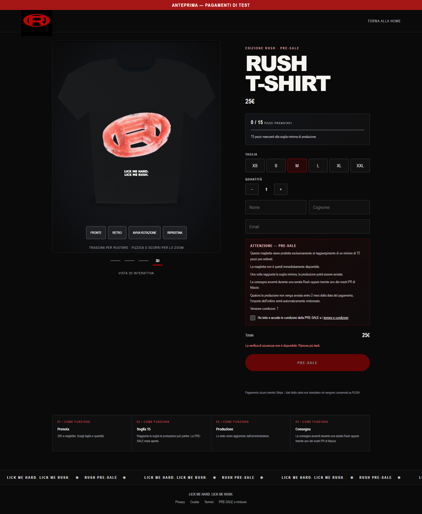
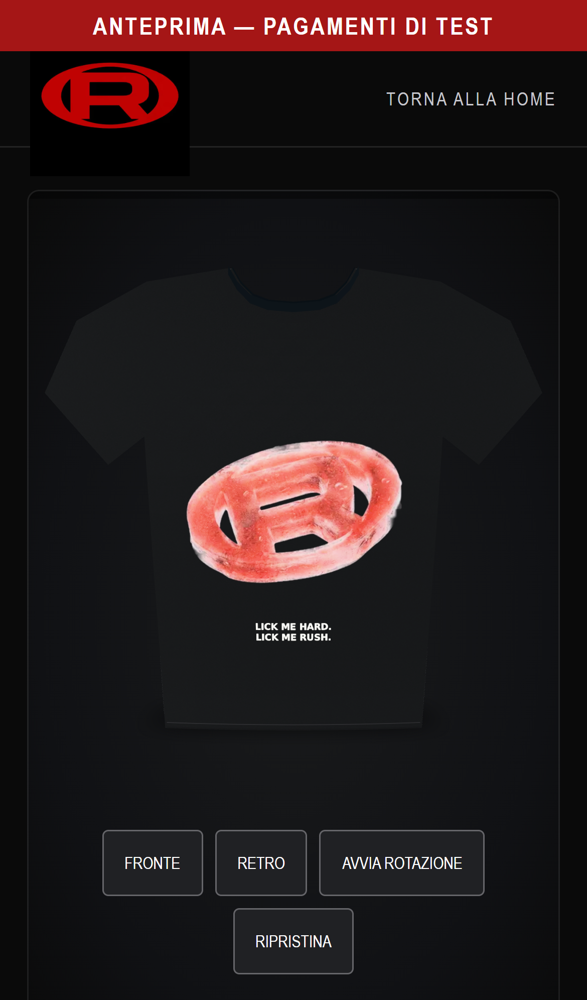
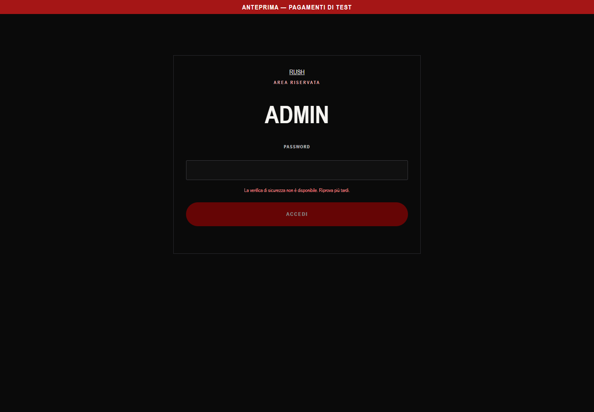
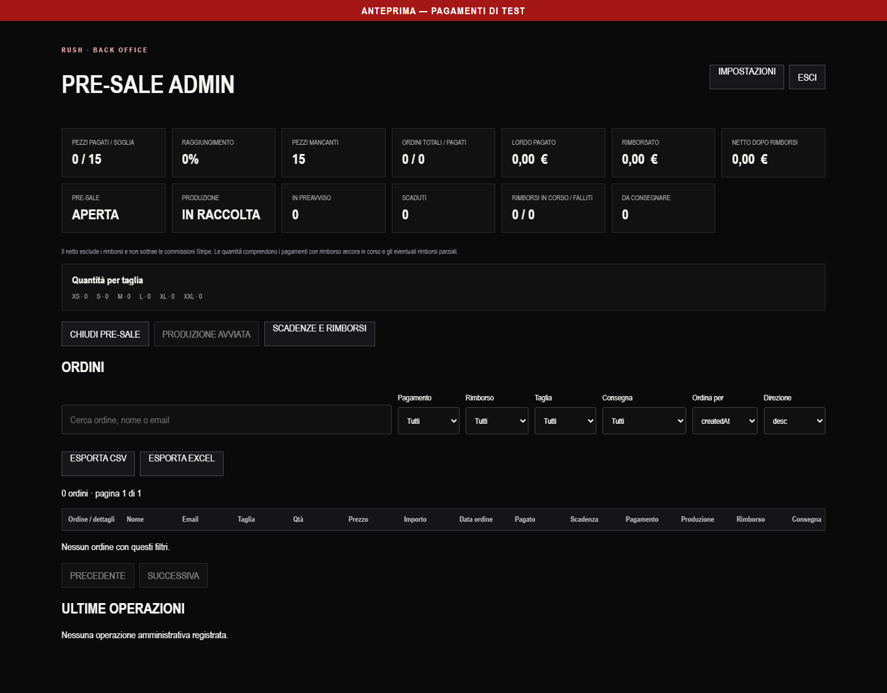
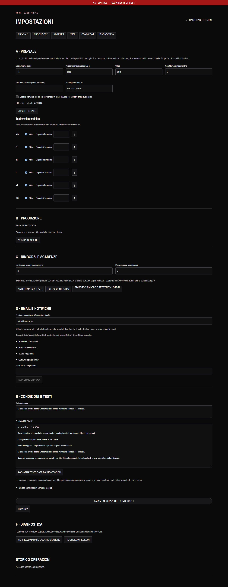
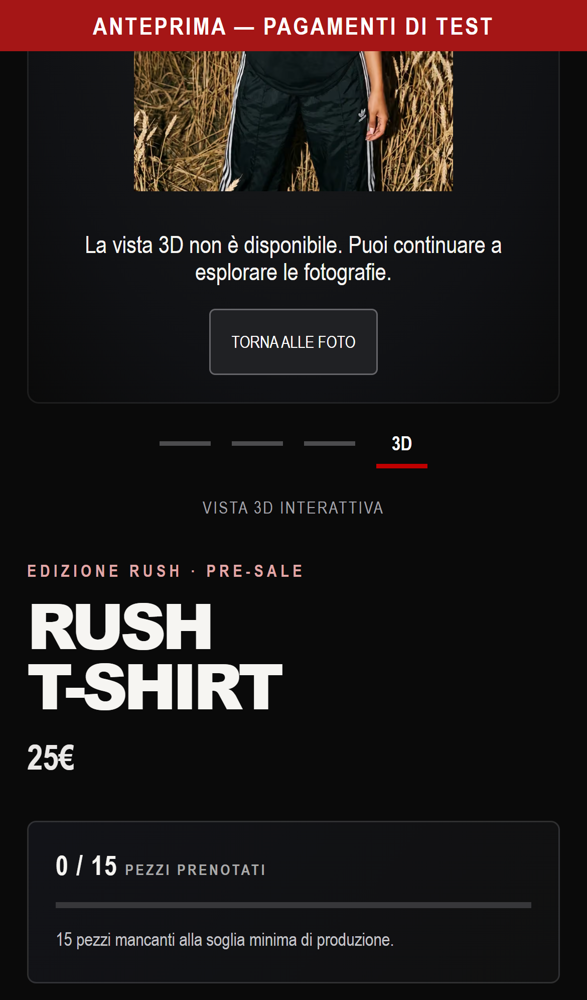

# Manuale d’uso RUSH Presale

## 1. Piattaforma e requisiti di utilizzo
RUSH Presale raccoglie prenotazioni pagate della maglietta RUSH. Il prezzo iniziale è 25 EUR; la soglia iniziale di produzione è 15 pezzi. Prezzo e soglia correnti sono quelli pubblicati nella pagina PRE-SALE. La produzione richiede una conferma amministrativa distinta dalla chiusura della raccolta.

Occorrono connessione Internet, browser aggiornato e JavaScript attivo. Il modello 3D richiede WebGL; quando non può essere visualizzato, restano utilizzabili le fotografie. Non occorre un account cliente. Il backoffice richiede invece un amministratore attivo inizializzato nel database. Gli screenshot rappresentano il collaudo locale del candidato 2.2.0, con database isolato e nessun ordine commerciale.

## 2. Navigazione e pagina prodotto
Aprire la home e selezionare PRE-SALE. Il logo identifica il servizio. La pagina prodotto riunisce fotografie, visualizzatore, prezzo, contatore, taglie, quantità e modulo di prenotazione. Il collegamento TORNA ALLA HOME riporta all’ingresso. Privacy, cookie, termini e rimborsi sono raggiungibili dal piè di pagina.

Il contatore considera le quantità pagate e non integralmente rimborsate; si aggiorna ogni 15 secondi. Un pagamento ancora in elaborazione non incrementa il contatore. Il superamento della soglia non impedisce ulteriori prenotazioni mentre la raccolta resta aperta.

## 3. Fotografie e visualizzazione 3D
I primi tre selettori sotto l’immagine mostrano fronte, retro e dettaglio della stampa. Toccare una fotografia per ingrandirla; chiudere con il pulsante ×, un clic nell’ingrandimento oppure Esc. Sul touchscreen è possibile scorrere le foto orizzontalmente.

Selezionare 3D per caricare il modello tridimensionale nella stessa galleria. Il primo caricamento dipende dalla connessione; un indicatore mostra l’avanzamento. Il file modello pesa circa 5,9 MiB e contiene le texture. I comandi diventano disponibili quando il caricamento è terminato.

| Comando | Risultato |
|---|---|
| Trascinamento mouse o dito | Rotazione manuale della maglietta |
| Rotella o gesto a due dita | Zoom limitato alla distanza configurata |
| FRONTE / RETRO | Vista scelta e arresto della rotazione automatica |
| FERMA ROTAZIONE / AVVIA ROTAZIONE | Pausa o ripresa della rotazione |
| RIPRISTINA | Posizione frontale, inquadratura e zoom iniziali; rotazione ferma |
| Selettori fotografici | Ritorno alle fotografie senza ricaricare la pagina |

La rotazione del modello non cambia la voce del carosello. Se il dispositivo richiede movimenti ridotti, la rotazione automatica iniziale rimane disattivata. Il passaggio a una scheda del browser nascosta ferma la rotazione; può essere riavviata dal controllo dedicato. Il modello fornito è una rappresentazione approssimata: le fotografie restano il riferimento visivo del prodotto.

## 4. Taglie, quantità e condizioni
Selezionare una taglia disponibile fra XS, S, M, L, XL e XXL. Le taglie disabilitate dall’amministratore non vengono proposte. Usare + e − per la quantità; il totale segue il prezzo corrente. Il cambio foto/3D conserva taglia e quantità.

Compilare nome, cognome ed email, leggere le condizioni e selezionare l’accettazione. Se le condizioni o il listino cambiano durante la visita, l’accettazione viene richiesta nuovamente. La verifica anti-bot deve essere completata prima di attivare PRE-SALE. La disponibilità definitiva viene controllata dal server quando si avvia l’ordine.

## 5. Pagamento, conferma e rimborso
PRE-SALE apre il Checkout ospitato da Stripe. Il sito non conserva i dati completi della carta. Dopo il pagamento il ritorno automatico alla conferma mostra lo stato verificato dal server sia su Stripe sia nell'ordine registrato; il solo ritorno dal provider non prova che il pagamento sia riuscito. Conservare il codice ordine e l’email ricevuta.

La pagina mostra codice ordine, RUSH T-SHIRT, taglia, quantità e totale. Solo dopo conferma attendibile compaiono totale pagato, metodo effettivo (carta o wallet rilevato), circuito/ultime quattro cifre se disponibili e data/ora italiana. Durante l'elaborazione non ripetere il pagamento: la pagina ricontrolla automaticamente per circa un minuto e poi offre RICONTROLLA PAGAMENTO. Un errore di verifica non equivale a un pagamento fallito; non procedere a un secondo acquisto senza verificare l'ordine. L'annullamento nel Checkout riporta alla pre-sale con un avviso.

La consultazione richiede lo stesso browser che ha iniziato il checkout e il relativo cookie tecnico, valido sette giorni. Il ricaricamento è consentito; il solo codice ordine non autorizza l'accesso. Da un altro dispositivo, dopo cancellazione/scadenza del cookie o per ordini anteriori a questa modifica, contattare l'assistenza: non esiste una procedura automatica di recupero dell'accesso cliente. TORNA ALLA HOME riporta alla pagina iniziale.

Ogni ordine memorizza prezzo, condizioni e data di pagamento. La scadenza iniziale è due mesi di calendario dal pagamento, con adeguamento all’ultimo giorno valido del mese. Se la produzione non è stata avviata alla scadenza, il processo pianificato richiede il rimborso. La conferma arriva dopo l’esito di Stripe; i tempi di accredito dipendono dal metodo di pagamento.

La consegna avviene durante una serata RUSH o tramite PR, secondo le condizioni accettate. La piattaforma non gestisce una spedizione tradizionale. Con PRE-SALE CHIUSA non si possono avviare nuove prenotazioni. Gli ordini precedenti restano gestibili nell'area amministrativa; la consultazione cliente richiede il cookie valido descritto sopra.

## 6. Accesso amministrativo
Aprire /admin/login, inserire email e password del proprio account e completare la verifica anti-bot. L’account principale mantiene anche l’accesso con sola password, lasciando vuota l’email. Un errore non rivela se l’account esiste. Dopo dieci tentativi nella finestra di 15 minuti il server rifiuta ulteriori accessi da quella sorgente. In locale, fuori dalle build di produzione, il controllo CAPTCHA è escluso soltanto su loopback.

La sessione dura al massimo 12 ore. ESCI revoca la sessione nel database e rimuove il cookie. Disattivazione dell’account, modifica dell’hash salvato, rotazione del segreto di sessione o della configurazione legacy invalidano le sessioni interessate. Se il database non risponde, l’accesso viene negato.

Un nuovo amministratore personale deve essere creato da un gestore autorizzato con la [procedura di provisioning](../14_ADMIN_PERSONALE.md). La password si imposta nel terminale locale con input nascosto, mai in chat. La creazione non cambia l’amministratore principale; ogni sessione identifica il proprio account e può essere revocata separatamente. Il provisioning non è una procedura di recupero password.

## 7. Dashboard, ordini e produzione
La dashboard presenta pezzi pagati/soglia, percentuale, quantità mancanti, ordini totali e pagati, lordo, rimborsato, netto, produzione, preavvisi, scaduti e consegne. Il netto non sottrae le commissioni Stripe. I rimborsi parziali e quelli ancora in corso sono distinguibili dal rimborso completo.

CHIUDI PRE-SALE blocca nuove richieste e tenta l’annullamento dei Checkout aperti. Un avviso di riconciliazione richiede controllo in diagnostica; non significa che gli ordini siano stati cancellati. AVVIA PRODUZIONE richiede soglia raggiunta e assenza di rimborsi automatici ambigui. L’avvio è irreversibile e deve corrispondere all’avvio effettivo. PRODUZIONE COMPLETATA è disponibile soltanto dopo l’avvio.

Ricercare ordini per codice, nome o email e applicare filtri per pagamento, rimborso, taglia e consegna. L’elenco usa 25 righe per pagina. CSV ed Excel rispettano i filtri; il foglio Produttore riepiloga i pezzi per taglia. Oltre 10.000 righe occorre restringere la ricerca. Conservare gli export soltanto nei luoghi autorizzati.

La consegna è modificabile per un ordine pagato senza rimborso. Le opzioni sono DA CONSEGNARE, SERATA RUSH, PR e CONSEGNATA. Prima di confermare RIMBORSA controllare codice e importo: è un’azione economica nell’ambiente configurato. Per un rimborso PENDING usare RICONCILIA; non duplicare l’operazione manualmente.

## 8. Impostazioni
Il sito riguarda un unico prodotto: non esiste un catalogo multi-prodotto. Le impostazioni amministrano prezzo, soglia, disponibilità delle sei taglie, massimi di acquisto, manutenzione, durata dei nuovi ordini, preavviso, consegna, destinatari e testi email.

Le modifiche richiedono SALVA IMPOSTAZIONI. RICARICA scarta quelle non salvate dopo conferma. Un conflitto di revisione richiede di ricaricare e ripetere l’operazione; evita che una sessione sovrascriva modifiche di un’altra. Aggiornare il testo delle condizioni quando cambiano soglia, durata o consegna; le clausole obbligatorie non possono essere rimosse. Gli ordini esistenti mantengono i propri dati contrattuali.

Anteprima scadenze è una lettura. Esegui controllo, invio email di prova e riconciliazione possono produrre effetti esterni dopo conferma. Questi strumenti sono riservati al backoffice e restano necessari alla manutenzione.

## 9. Errori e risoluzione dei problemi
| Sintomo | Azione |
|---|---|
| Stato PRE-SALE non disponibile | Attendere e riprovare; il checkout resta bloccato finché i dati non sono disponibili |
| Condizioni cambiate | Rileggere il testo corrente e accettarlo nuovamente |
| Verifica anti-bot non completata | Usare Riprova verifica; aprire il sito direttamente in un browser aggiornato |
| Vista 3D non disponibile | Tornare alle foto; controllare connessione e supporto WebGL |
| Credenziali non valide | Verificare la password dell’account inizializzato; rivolgersi al gestore tecnico |
| Troppi tentativi | Attendere la scadenza della finestra del limitatore |
| Checkout non disponibile | Riprovare con gli stessi dati; la chiave del tentativo limita i duplicati |
| Rimborso in corso | Verificare il provider e riconciliare; non presumere un fallimento |

Segnalare codice ordine, operazione, orario e messaggio, senza password, token, dati carta o URL del database. Il banner PAGAMENTI DI TEST identifica un ambiente di collaudo: scompare solo con configurazione applicativa production e Stripe live. La validazione commerciale e i contatti autentici del venditore restano prerequisiti del lancio.
