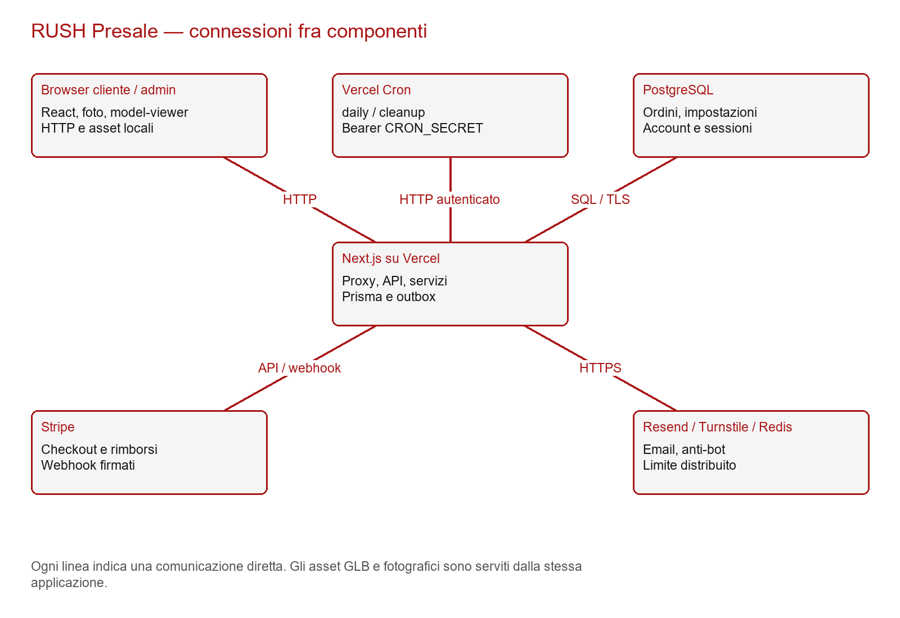
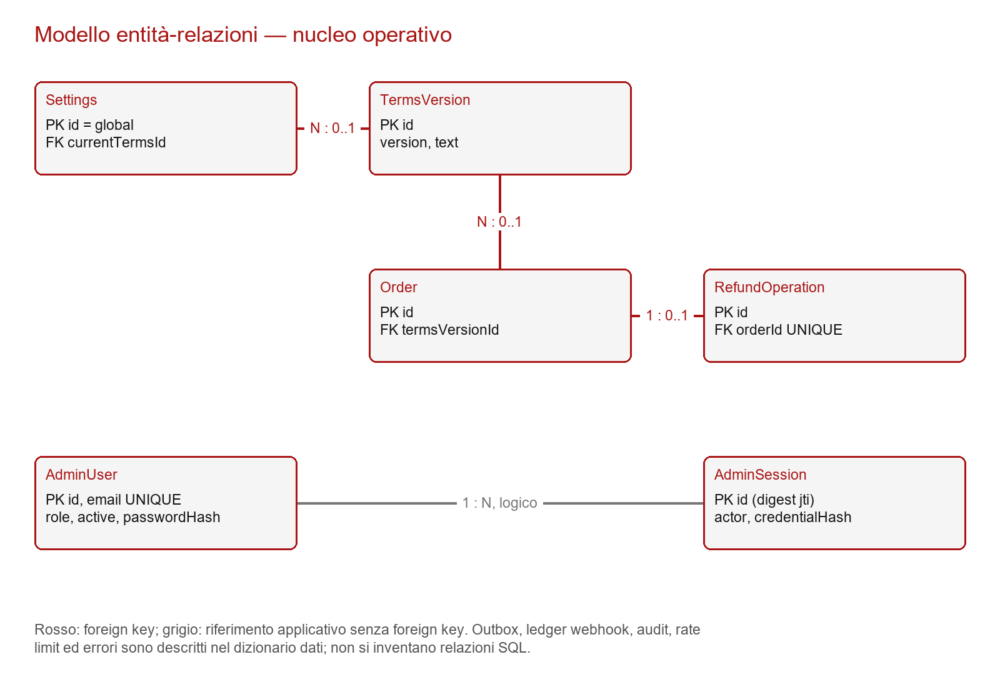

# TAD — Architettura tecnica RUSH Presale

Aggiornamento del 28 ottobre 2026: [gate e verifiche finali](../11_FINALIZZAZIONE_LIVE.md), [matrice test](../12_CASI_TEST_FINALI.md). Gli allegati Office/screenshot del 27 ottobre documentano la baseline precedente.

## 1. Perimetro e decisioni architetturali
Il candidato 2.2.0 estende la baseline 0e3ee36 nel repository vicente490x/rush-presale. Next.js App Router serve pagine, API e proxy; Prisma accede a PostgreSQL. Il browser non è autorevole per prezzo, stato economico o autorizzazione. Stripe ospita il pagamento; Resend gestisce l’invio email; Cloudflare Turnstile valida l’interazione anti-bot; Upstash Redis limita il checkout. Non sono introdotti backend alternativi, autenticazione esterna o storage remoto per il GLB.

La specifica riguarda un prodotto unico. Le impostazioni sono un singleton con ID global; non esiste una tabella Product. L’account amministrativo persistente riutilizza le sessioni esistenti, aggiungendo un controllo sullo stato dell’identità e sull’impronta della credenziale. Le strutture storiche try-on ignorate da Prisma restano nel database per evitare una migrazione distruttiva.

## 2. Stack e dipendenze
La tabella delle versioni risolte dal lockfile è riportata nell’appendice tecnica. Il runtime dichiarato è Node >=22 <25, con Node 24 usato nel collaudo. Next 16.4.2, React 19, TypeScript, Prisma 6.12 e PostgreSQL costituiscono la base applicativa. Le versioni esatte delle librerie dipendono dal lockfile committato, non da un’installazione globale.

La dipendenza aggiunta @google/model-viewer 4.4.0 porta il motore Three.js tramite il proprio grafo. Non viene aggiunta una seconda implementazione Three.js diretta. @playwright/test è una dipendenza di sviluppo per il collaudo browser. Python, python-docx, openpyxl e Pillow servono soltanto alla documentazione e non vengono installati nel runtime Vercel. npm ci applica il lockfile; postinstall esegue prisma generate. La build rigenera il client Prisma e compila Next.

## 3. Struttura e responsabilità
| Percorso | Responsabilità |
|---|---|
| app/ | Layout, pagine, Route Handler e CSS globale |
| components/ | Storefront, galleria, RushShirt3D, conferma, login, dashboard e impostazioni |
| lib/ | Regole commerciali, sicurezza, database, provider, export e configurazione |
| prisma/schema.prisma | Modello PostgreSQL, enum, indici, relazioni e strutture storiche ignorate |
| prisma/migrations/ | Migrazioni ordinate e immutabili |
| public/assets/ | Logo, fotografie e modello nella sottocartella models |
| scripts/ | Gestione ambiente, amministratore, collaudo, audit e documenti |
| tests/ | Casi unitari e integrazione applicativa |
| docs/ | Dossier, documenti Office, sorgenti, registro ed evidenze |
| .github/workflows/ | Installazione, audit e regressione CI |
| proxy.ts | Sessione admin, nonce CSP e cache per ogni richiesta |
| vercel.json | Pianificazione daily e cleanup |

## 4. Frontend e comunicazione
RootLayout usa rendering dinamico per il nonce per risposta. HomeHero presenta il marchio e la CTA PRE-SALE. Storefront interroga /api/status ogni 15 secondi, conserva taglia e quantità e invalidata l’accettazione quando cambia la revisione. Il modulo invia solo dati cliente, variante e identificativi del tentativo/condizioni; il prezzo viene ricalcolato sul server.

ImageGallery contiene tre viste fotografiche e una slide 3D. Il dialogo fotografico usa il controllo nativo dialog. RushShirt3D viene importato con next/dynamic e ssr:false; a sua volta importa model-viewer soltanto dopo il montaggio. La selezione del prodotto appartiene al componente superiore e sopravvive allo smontaggio del viewer.

AdminDashboard carica KPI e ordini in parallelo, ripete le letture ogni 30 secondi e scarta risposte appartenenti a una ricerca superata. AdminSettings mantiene la revisione caricata; il server rifiuta scritture basate su una revisione obsoleta. Le azioni economiche e di stato richiedono conferma nell’interfaccia e validazione server.

## 5. Backend e confini HTTP
Le API amministrative passano attraverso adminRoute, che richiama requireAdmin anche se proxy.ts ha già autorizzato la richiesta. Le pagine admin richiamano requireAdminPage. Questo impedisce che l’autorizzazione dipenda solo dal middleware o dall’interfaccia. Login è l’unico endpoint admin pubblico e applica protezioni proprie.

readBytes limita il corpo mentre lo legge, senza fidarsi soltanto di Content-Length; readJson restituisce errore controllato per JSON malformato. Le mutazioni amministrative e l’ordine richiedono Origin canonica e rifiutano sec-fetch-site cross-site. Schemi Zod con proprietà consentite limitano l’assegnazione arbitraria di stati/importi. I contratti API completi sono nell’appendice dedicata.

I servizi checkout, presale, admin-operations, refunds ed expiry orchestrano le transazioni. Gli handler traducono DomainError in status HTTP e registrano codici fissi per gli errori inattesi. Le risposte sull'ordine omettono nome/email e oggetti grezzi Stripe. Il codice casuale è un riferimento, non una credenziale sufficiente: GET /api/orders/:orderNumber richiede un cookie HMAC associato all'ordine e valido sette giorni, emesso insieme al checkout, HttpOnly/Secure/SameSite=Lax e limitato a /api/orders. Il segreto SESSION_SECRET è utilizzato con namespace distinto dalle sessioni admin. Un cookie per ordine supporta più acquisti nello stesso browser. Rotazione del segreto invalida anche questi accessi.

La conferma recupera la Session registrata nel DB espandendo payment_intent.latest_charge. Il validatore confronta modalità TEST/LIVE, importo, valuta, metadata, stato e riferimenti Session/Intent/Charge. PAID richiede anche il PAID nel DB, prodotto dal webhook firmato e idempotente; la GET non effettua scritture economiche. Pending, API non disponibile e mismatch non diventano successi. Le risposte non sono memorizzabili. L'interfaccia effettua polling ogni tre secondi per circa un minuto e consente riprova; mostra soltanto i dati minimizzati derivati dal Charge. Le date sono UTC nel backend ed Europe/Rome nell'interfaccia. I metodi abilitati nel checkout restano carta e relativi wallet supportati; il parser non inventa dettagli se assenti.

## 6. Modello dati e relazioni

Order conserva dati cliente, taglia/quantità, importi interi in centesimi, date UTC, riferimenti Stripe, stati, chiave checkout e snapshot contrattuali. TermsVersion conserva il testo numerato; Settings referenzia la versione corrente, Order quella accettata. RefundOperation ha un vincolo univoco su orderId e sulla chiave idempotente. EmailOutbox ha dedupeKey univoca. StripeWebhookEvent usa l’ID provider come chiave primaria.

AdminUser contiene ID, email univoca normalizzata, ruolo enum ADMIN, passwordHash, active e date. AdminSession contiene digest del jti, actor, credentialHash, scadenza e revoca. actor è un riferimento logico all’identità configurata, non una foreign key: ciò preserva le sessioni storiche, che comunque vengono invalidate se manca l’impronta o l’account. Non esiste una tabella utenti clienti.

AuditLog registra attore, azione, entità e valori prima/dopo. ApplicationError conserva codici minimizzati. RateLimitEntry implementa contatori e scadenze; WebhookReceipt traccia le ricezioni autenticate. TryOnJob, TemporaryTryOnAsset e alcuni campi Settings sono ignorati dal client e non alimentano funzionalità pubbliche.

Gli indici principali coprono pagamento/rimborso, scadenza, email, outbox, audit e sessioni. La migrazione iniziale e quelle di consolidamento contengono ulteriori vincoli e trigger per importi coerenti e monotonicità della produzione. La lista dei campi effettivi è nell’appendice ricavata dallo schema del candidato.

## 7. Transazioni, concorrenza e idempotenza
lockSettings acquisisce la riga global con SELECT FOR UPDATE. Prenotazione, cambiamenti amministrativi, conferma pagamento, soglia e rimborsi condividono questo punto di serializzazione. I lock proteggono la disponibilità concorrente e la gara fra avvio produzione e rimborso. Alcune chiamate provider nei rimborsi mantengono la transazione aperta; i timeout e il dimensionamento del pool richiedono monitoraggio.

checkoutKey è univoca e associata a un fingerprint dei dati. Riutilizzare la chiave con dati diversi è rifiutato. Lo snapshot dell’ordine preserva prezzo, valuta, termini, consegna e durate. Stripe riceve idempotencyKey checkout:<id>. La conferma verifica evento e riferimenti prima di aggiornare il pagamento e inserire l’ID nel ledger.

RefundOperation viene scritta prima della chiamata esterna. La riconciliazione controlla valuta, payment intent, importi e duplicati. Il totale rimborsato non può regredire a causa di un evento fuori ordine. Un timeout mantiene l’incertezza esplicita. La notifica usa dedupeKey; i worker email acquisiscono un lease prima dell’invio e registrano l’accettazione del provider.

## 8. Autenticazione e autorizzazioni
initializeAdmin valida ID/email, applica bcrypt costo 12 a una password di almeno 16 caratteri e massimo 72 byte UTF-8 senza caratteri di controllo, oppure importa un hash bcrypt valido costo 12–16. createMany(skipDuplicates) insieme ai vincoli unici impedisce duplicazioni concorrenti; il successivo controllo dell’identità rileva i conflitti. Un account esistente non viene aggiornato e non viene riattivato implicitamente.

authenticateAdmin legge solo AdminUser corrispondente ad ADMIN_ID e richiede active e ruolo ADMIN. Nessun hash nell’ambiente concede da solo l’accesso. Il form resta a password singola perché il backoffice è progettato per l’identità configurata. L’email è un dato dell’account e della configurazione notifiche, non un identificativo digitato al login.

createAdminSession usa jti casuale di 32 byte, JWT HS256, subject, ruolo ADMIN, issuer rush-admin, audience rush-backoffice e scadenza 43.200 secondi. La chiave deriva da SESSION_SECRET e dall’eventuale ADMIN_PASSWORD_HASH legacy, conservando la revoca per rotazione di configurazione. AdminSession salva SHA-256 del jti e SHA-256 dell’hash password. La verifica confronta identità, active, ruolo, impronta, scadenza e revoca. Il parametro expectedHash impedisce di emettere una sessione con una credenziale cambiata fra verifica password e creazione.

Il cookie rush_admin_session è HttpOnly, SameSite Strict, path /, Secure nelle build production e negli ambienti non-development. La durata massima è 12 ore e non esiste rinnovo silenzioso. Logout revoca la riga prima di cancellare il cookie. La pulizia rimuove sessioni scadute. Un errore DB non produce accesso di fallback.

Il budget login è dieci richieste per IP in 15 minuti, persistito atomicamente in PostgreSQL. Su Vercel si usa il forwarded IP normalizzato della piattaforma; fuori Vercel si usa un bucket condiviso, evitando IP forniti arbitrariamente dal client. Turnstile è validato server-side; l’eccezione locale vale solo in development non-production e hostname loopback.

## 9. Asset e viewer GLB
Il modello proviene da RUSH_Maglietta_3D_Web(2).zip e viene copiato byte per byte in public/assets/models/rush-oversized-shirt.glb. Texture e geometria sono incorporate nel GLB v2. Le immagini JPEG e le grafiche PNG di riferimento dello ZIP non sono necessarie al runtime e non vengono duplicate. Il file HTML del pacchetto non viene pubblicato come pagina separata.

Il componente fornito è adattato con eventi load/progress/error, timeout, fallback, reset, controlli limitati, pulizia listener e preferenza reduced-motion. Il GLB resta raggiungibile come asset statico. proxy.ts lo esclude dalla regola no-store applicata alle pagine e API; non viene impostata una cache immutable su un nome non versionato. Non sono richiesti decoder su CDN per questo asset.

Il decoder incluso nel grafo di model-viewer inizializza WebAssembly. La CSP contiene wasm-unsafe-eval, distinto da unsafe-eval JavaScript, che rimane assente in produzione. La policy deve essere coerente fra le pagine di ingresso perché la navigazione client Next conserva la CSP del documento iniziale. L’errore è stato rilevato e corretto nel collaudo browser; non è stato risolto disabilitando la CSP.

## 10. Sicurezza, cache ed errori
Il proxy genera un nonce casuale per risposta e lo propaga al rendering. Sono impostati frame-ancestors none, object-src none, script-src-attr none, referrer-policy no-referrer, HSTS e nosniff. Gli script autorizzati sono locali e Turnstile; lo stile inline è consentito per i componenti esistenti. Il viewer usa le stesse origini per script e modello. L’optimizer Next accetta soltanto i tre asset fotografici/logo configurati e rifiuta API interne e URL esterni.

HTML e API restano private/no-store anche sulle cache CDN. Stripe usa la propria pagina di pagamento e firma webhook. Redis nega checkout su timeout; Turnstile rifiuta hostname non coerente, token mancante/scaduto e errore provider. Gli export neutralizzano formule. Gli errori di inizializzazione admin non stampano eccezioni Prisma o validazioni contenenti valori sottoposti.

La protezione non equivale a un penetration test indipendente. Il modello distribuito è statico e non esiste upload di GLB da utenti. La retention dei dati personali, gli accessi ai log del provider e i contatti legali devono essere definiti dal titolare.

## 11. Configurazione ambiente
Le variabili sono descritte nel catalogo dell’appendice. .env.example, .env.staging.example e .env.production.example contengono modelli senza credenziali. NEXT_PUBLIC_SITE_URL e NEXT_PUBLIC_TURNSTILE_SITE_KEY sono valori pubblici; database, hash e segreti rimangono server-side. Le URL PostgreSQL remote richiedono TLS con sslmode=require e sslaccept=strict per Prisma 6.

ADMIN_PASSWORD serve soltanto al bootstrap e non deve essere memorizzata nei file di runtime. ADMIN_PASSWORD_HASH può essere prodotto dal generatore interattivo e importato nell’account. Il preflight corrente mantiene il controllo di formato dell’hash per compatibilità con l’operatività esistente; dopo la migrazione il login legge comunque la credenziale dal DB. Non cambiare il valore nell’ambiente presumendo che aggiorni AdminUser: il bootstrap non sovrascrive account presenti.

Per inizializzare in locale: configurare .env.local, ADMIN_EMAIL e connessioni; eseguire db:migrate, admin:setup e create-admin. admin:setup chiede la password senza mostrarla e scrive hash/segreto nel file ignorato. Per staging/production usare create-admin -- --env-file <file-dedicato>, dopo il controllo della destinazione. Il comando valida conferma ambiente e URL e non eredita URL mancanti dal processo.

## 12. Migrazioni e compatibilità
Le quattro migrazioni sono 20261013000100_initial, 20261016000100_staging_hardening, 20261016000200_security_sessions e 20261027000100_admin_users. L’ultima crea enum e tabella AdminUser e aggiunge credentialHash nullable ad AdminSession. Non cancella dati, non modifica ordini e non copia automaticamente segreti dal server al DB.

Sequenza di rilascio: backup verificato, migrate status, applicazione additiva, bootstrap dell’account con hash autorizzato, deploy candidato e nuovo login. Le sessioni precedenti devono autenticarsi nuovamente. Le migrazioni non partono dalla build Vercel. Non usare db push, reset o seed commerciale. Il test di migrazione parte dalla struttura iniziale e verifica preservazione di ordini, importi, date e vincoli; il bootstrap deve essere testato separatamente sulla destinazione.

Un rollback del codice non annulla lo schema o gli effetti dei provider. La tabella additiva può rimanere durante il rollback, ma il vecchio codice usa l’hash d’ambiente: valutare credenziali e revoche prima di ripristinarlo. Non eliminare tabelle o righe per rendere il vecchio codice apparentemente compatibile.

## 13. Vercel e pianificazione
next.config.ts fissa il tracing root, disabilita poweredByHeader e limita l’optimizer. App Router e Route Handler usano runtime Node dove necessario. vercel.json pianifica daily alle 07:00 UTC e cleanup alle 07:30 UTC, rispettivamente 08:00 e 08:30 a Roma il 27 ottobre 2026. In estate locale gli orari cambiano rispetto a UTC. Gli endpoint richiedono Bearer CRON_SECRET.

Fuori da produzione, oppure con ENABLE_AUTOMATIC_JOBS diverso da true, daily esegue soltanto l’anteprima. In produzione esegue scadenze, riconciliazioni e invii entro budget e batch. Il piano Vercel deve supportare timeout e frequenza richiesti; una configurazione nel repository non dimostra l’esecuzione effettiva del job.

La CI esegue npm ci, audit, verify, integrazione PostgreSQL, migrazione, backup, HTTP e browser. PostgreSQL CI è isolato. I workflow si attivano anche sul branch feature/rush-final-release e sulle PR. Non sono stati eseguiti merge o pubblicazioni automatiche del candidato; i riferimenti remoti storici nei documenti precedenti non certificano questo commit.

## 14. Backup, ripristino e osservabilità
test:backup crea due database casuali, applica migrazioni, inserisce fixture, esporta con pg_dump custom, ripristina con pg_restore transazionale e confronta conteggi, importi, date, relazioni, outbox e checksum. Una modifica alla copia prova l’indipendenza dalla sorgente. Rimuove soltanto le proprie destinazioni. Questo risultato è una prova della procedura locale, non della politica commerciale o del suo RPO/RTO.

In esercizio servono frequenza, retention, cifratura, destinazione, responsabile e prova periodica su una copia separata. Le evidenze storiche Neon sono mantenute nel dossier, con data e contesto originali. Non vengono presentate come controlli ripetuti nel candidato attuale.

Monitorare ApplicationError, ricevute webhook, RefundOperation pendenti/fallite, EmailOutbox non consegnata, più batch da elaborare, disponibilità DB e latenza. release:audit effettua letture provider e riporta PASS/FAIL/OPEN senza modificare configurazioni; production:check è il controllo bloccante di formato/prerequisiti. Nessuno dei due sostituisce una transazione TEST completa.

## 15. Prestazioni e limiti
Il lock globale privilegia la coerenza; la serializzazione e le chiamate provider nelle transazioni possono limitare il throughput. L’elenco è paginato, l’export limitato, i job a batch e i body HTTP limitati. L’assenza di un test di carico impedisce di attribuire una capacità massima misurata.

Il viewer carica circa 5,9 MiB alla selezione oltre al modulo JavaScript. Il modello originale non viene ricompresso o ricostruito. Cache del browser, selezione esplicita e smontaggio riducono il costo sulle visite che usano soltanto fotografie. I dispositivi reali e browser diversi da Chromium emulato richiedono collaudo prima di garantire compatibilità universale.

## 16. Manutenzione e riferimenti
Aggiornare le dipendenze tramite lockfile, audit e regressione. Modifiche ai termini devono preservare gli snapshot; cambiamenti agli stati economici richiedono test di concorrenza e riconciliazione. La rotazione password amministrativa deve aggiornare in modo autorizzato l’hash di AdminUser: il comando di inizializzazione non è un comando di reset. Un pannello multi-admin o self-service di recupero password non è previsto e richiederebbe un’estensione separata.

Riferimenti consultati: documentazione ufficiale model-viewer https://modelviewer.dev/docs/; MDN script-src https://developer.mozilla.org/en-US/docs/Web/HTTP/Reference/Headers/Content-Security-Policy/script-src; SPEC.md; schema Prisma; route e servizi del candidato. Il repository https://github.com/vicente490x/Progetto-ATM e tools/genera_documenti.py sono stati consultati soltanto per l’organizzazione documentale.
